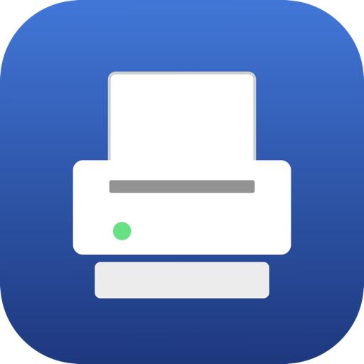
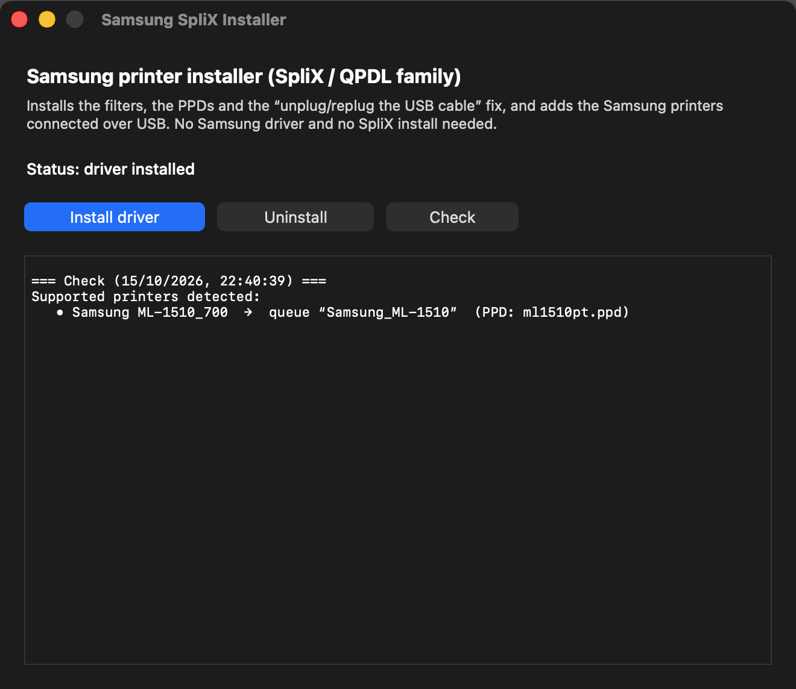
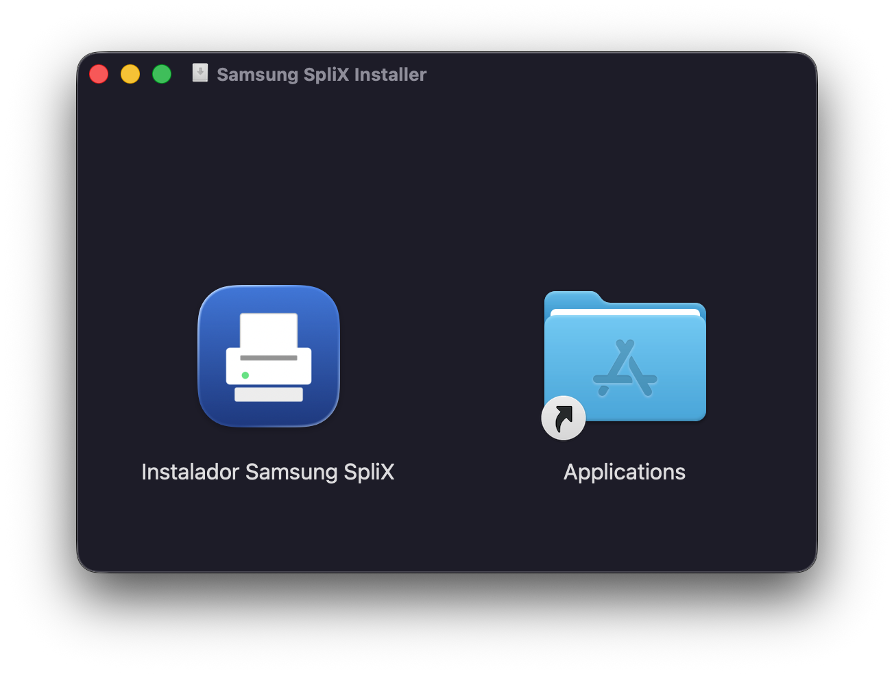
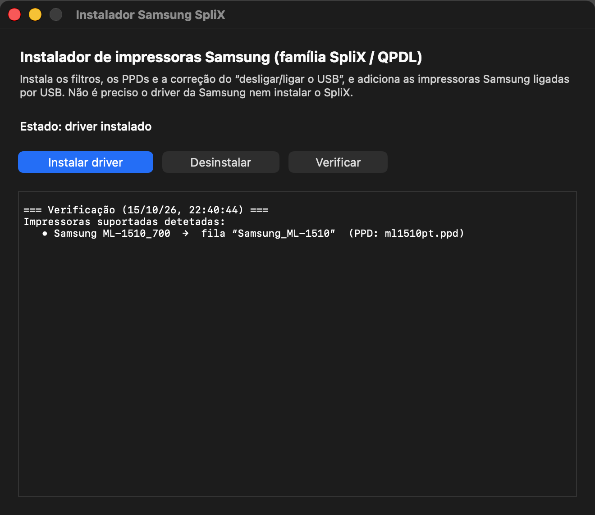
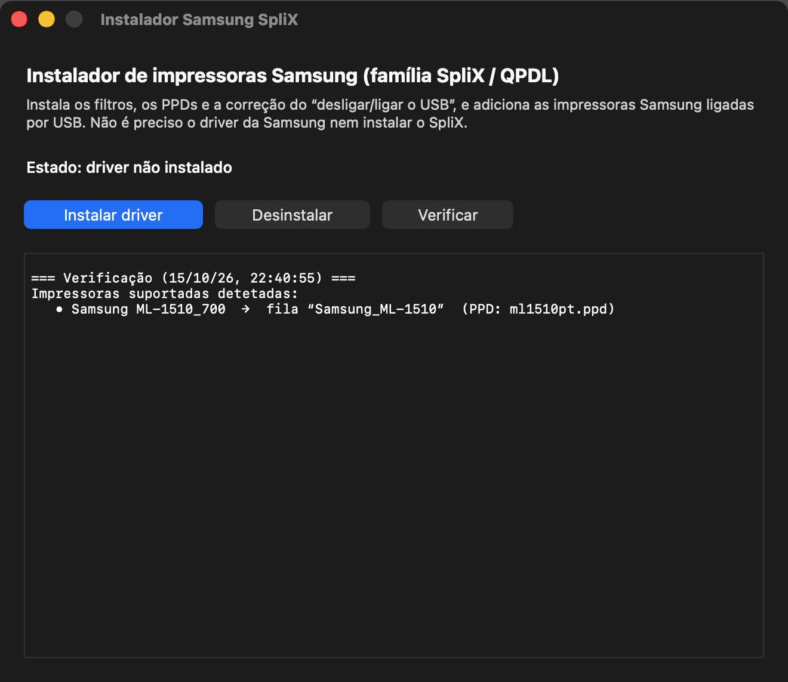

<h1 align="center">Samsung ML-1510 / ML-16xx / ML-17xx / ML-20xx / SCX — macOS Driver<br>
<sub>Apple Silicon &amp; Intel · one-click app · no SpliX install · fixes the “unplug the USB cable to print again” bug</sub></h1>

<p align="center">

</p>

<p align="center">

</p>

A single macOS app that installs a working driver for old **Samsung laser
printers** (the SpliX / QPDL / SPL “GDI” family) on modern macOS — including
Apple Silicon — **and cures the classic annoyance where you have to unplug and
replug the USB cable before every second print job.**

It works with the **Samsung ML-1510**, ML-1520, ML-1610, ML-1640, ML-1710,
ML-1740, ML-1910, ML-2010, ML-2240, ML-2250, ML-2510, ML-2571, ML-2580,
ML-3050, ML-3560, SCX-4200, SCX-4300 and ~60 more models (full list at the
bottom). No Samsung driver download, no separate SpliX install — everything is
bundled.

## Why this exists

The CUPS USB backend on macOS reconfigures the printer on every job. Many
Samsung GDI models are then left with the USB interface in a “stuck” state and
the next job is silently dropped — until you re-enumerate the device (unplug /
replug the cable, or power-cycle the printer).

This is a known CUPS bug that was fixed on Linux in 2011 and **never on macOS**:

- <https://github.com/apple/cups/issues/3964>
- <https://github.com/apple/cups/issues/3965>
- <https://bugs.launchpad.net/ubuntu/+source/cups/+bug/872483>

This app fixes it in software, with
`IOUSBDeviceInterface::USBDeviceReEnumerate` (the same call libusb uses to
reset a USB device on macOS), executed **by a custom CUPS backend, before the
printer is opened**. Doing it *before* opening the device is essential: CUPS
starts filters and the backend concurrently, so a reset from a filter can
invalidate the device handle the backend already holds.

## Download & install

1. Download the latest **`SamsungSpliXInstaller-x.y.dmg`** from the
   [**Releases**](../../releases) page.
2. Open the DMG and drag **Samsung SpliX Installer** into **Applications**.
3. The app is not notarized (no paid Apple Developer account), so the first
   time: **right-click the app → Open → Open** (or run
   `xattr -dr com.apple.quarantine "/Applications/Samsung SpliX Installer.app"`).
4. Connect the printer by USB, open the app and click **Install driver**
   (authenticate in the macOS dialog).
5. Print a page, then print another one **without touching the cable** — both
   should come out.

The app detects the printer, installs the right PPD, and creates the print
queue for you.

<p align="center">

</p>

> Tested on macOS 26 “Tahoe” (Apple Silicon) with a Samsung ML-1510.

## What it installs

| Path | What |
|---|---|
| `/Library/Printers/Splix/rastertoqpdl`, `pstoqpdl` | SpliX filters, **universal (arm64 + x86_64)**, linked only against `/usr/lib/libcups*` |
| `/Library/Printers/Splix/splixreset` | USB re-enumeration helper (universal) |
| `/Library/Printers/Splix/splixusb` | CUPS backend: resets the USB device, then calls the stock `usb` backend |
| `/usr/libexec/cups/backend/splixusb` | symlink so CUPS finds the backend |
| `/Library/Printers/PPDs/Contents/Resources/Samsung <model> (SpliX).gz` | 78 PPDs (whole SpliX family) |
| a CUPS queue per connected printer | `DeviceURI = splixusb://Samsung/<model>?serial=…` |

Nothing is patched in place; **Uninstall** removes everything and the print
queues it created.

## Screenshots

| Detected printer (EN) | Installed (EN) | Before install (PT) |
|---|---|---|
|  |  |  |

The app is localised: **English by default**, Portuguese automatically when the
system language is Portuguese.

## Troubleshooting

Check that the reset runs on every job (this prints once per job):

```sh
grep splixreset /var/log/cups/error_log | tail
```

You should see:

```
[Job N] splixreset: looking for vid=04e8 pid=*0000 serial=… name=ML-1510_700
[Job N] splixreset: device is back
[Job N] splixreset: settling 2 s
```

- **The printer is not listed** — check it is connected:
  `/usr/libexec/cups/backend/usb`. Then click **Check** again.
- **“no matching PPD”** — the model is not in the SpliX list.
- **The queue is stopped** — macOS stops the queue when the backend fails
  (e.g. printer off): `cupsenable <queue>`.
- Install log: `/var/log/splixinstaller.log`.

## Build from source

Requirements: Xcode Command Line Tools, and CUPS headers **only to compile the
SpliX filters** (`brew install cups` — the built app does not depend on
Homebrew).

```sh
git clone https://github.com/peekpt/samsung-printer-macos-driver
cd samsung-printer-macos-driver
bash app/build.sh        # -> dist/Samsung SpliX Installer.app and *.dmg
```

Repository layout:

```
app/src/main.swift          Swift/AppKit UI
app/Resources/scripts/      install.sh / uninstall.sh (run as root)
app/Resources/backend/      splixusb CUPS backend
app/Resources/{bin,ppd}     compiled payload
app/icon/                   icon + DMG background drawn in code
src/splixreset.c            USB re-enumeration helper
vendor/splix/               SpliX source (GPL-2.0)
legacy/                     first prototype (filter-based) — obsolete
```

## License

- The bundled **SpliX** filters and PPDs are **GPL-2.0**. This project
  redistributes the binaries and ships the licence (`LICENSE.splix`), the
  notice (`NOTICE`) and the **complete corresponding source**
  (`app/Resources/licenses/splix-source.tar.gz`) inside the app, as the GPL
  requires.
- The application itself (`splixreset.c`, the shell scripts and the UI) is
  released under the **MIT License** (see `LICENSE`).

---

## Português

Uma app macOS que instala o driver para impressoras Samsung antigas (família
SpliX / QPDL: ML-1510, ML-2010, ML-2510, SCX-4200, …) em macOS moderno,
incluindo Apple Silicon, e resolve o problema de ter de **desligar e voltar a
ligar o cabo USB** antes de imprimir outra vez.

1. Descarrega o `.dmg` mais recente em [**Releases**](../../releases).
2. Abre o DMG e arrasta a app para **Aplicações**.
3. Como a app não está notarizada, à primeira vez faz **clique direito → Abrir
   → Abrir**.
4. Liga a impressora por USB, abre a app e clica **Instalar driver**.
5. Imprime uma página e depois outra **sem mexer no cabo**.

A interface está em inglês por defeito e muda para português automaticamente
se o idioma do sistema for português. O código é o mesmo; os binários do SpliX
são compilados nativamente para arm64 + x86_64 (sem Rosetta).

Licença: novo código em **MIT**; filtros/PPDs do **SpliX** em **GPL-2.0** (o
código-fonte correspondente vai dentro da app).

---

<!-- Everything below is for search engines: the full list of compatible printers. -->
<sub>

**Compatible printers / Impressoras compatíveis:** Dell 1100, Dell 1110, Lexmark X215 MFP, Samsung CLP-200, Samsung CLP-300, Samsung CLP-310, Samsung CLP-310N, Samsung CLP-315, Samsung CLP-500, Samsung CLP-510, Samsung CLP-550, Samsung CLP-600, Samsung CLX-216X, Samsung CLX-2170, Samsung CLX-3160, Samsung ML-1510, Samsung ML-1520, Samsung ML-1610, Samsung ML-1630, Samsung ML-1640, Samsung ML-1660, Samsung ML-1710, Samsung ML-1740, Samsung ML-1750, Samsung ML-1910, Samsung ML-1915, Samsung ML-2010, Samsung ML-2015, Samsung ML-2150, Samsung ML-2240, Samsung ML-2250, Samsung ML-2251, Samsung ML-2510, Samsung ML-2525, Samsung ML-2525W, Samsung ML-2550, Samsung ML-2571, Samsung ML-2580, Samsung ML-2580N, Samsung ML-3050, Samsung ML-3051, Samsung ML-3051ND, Samsung ML-3471ND, Samsung ML-3560, Samsung SCX-3200, Samsung SCX-4100, Samsung SCX-4200, Samsung SCX-4216F, Samsung SCX-4300, Samsung SCX-4500, Samsung SCX-4521F, Samsung SCX-4600, Samsung SCX-4623f, Samsung SCX-4623fw, Samsung SCX-5330N, Samsung SCX-5530FN, Samsung SF-565P, Toshiba eSTUDIO180S, Xerox Phaser 3115, Xerox Phaser 3116, Xerox Phaser 3117, Xerox Phaser 3120, Xerox Phaser 3121, Xerox Phaser 3122, Xerox Phaser 3124, Xerox Phaser 3130, Xerox Phaser 3140, Xerox Phaser 3150, Xerox Phaser 3155, Xerox Phaser 3160, Xerox Phaser 3420, Xerox Phaser 3425, Xerox Phaser 5500, Xerox Phaser 6100, Xerox Phaser 6110, Xerox WorkCentre 3119, Xerox WorkCentre PE114e, Xerox WorkCentre PE16.

Samsung ML-1510 driver macOS, ML-1510 Apple Silicon, ML-2010 macOS driver,
ML-2510 driver mac, SCX-4200 driver macOS, Samsung printer replug USB bug,
"samsung ml-1510 macos sonoma sequoia tahoe driver", SpliX macOS, QPDL, SPL,
GDI printer, CUPS USB backend reset, printer needs unplugging every time.

</sub>
